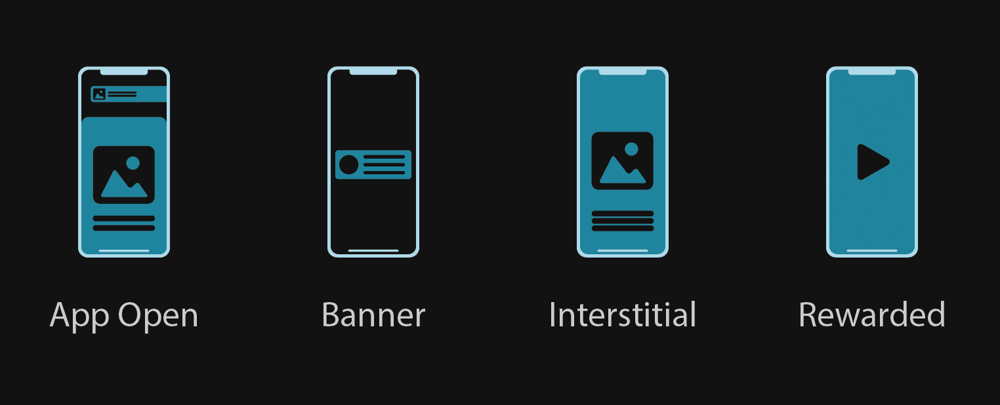

Unreal Engine · Mobile Advertising

Mobile ads. Built for Unreal.

A complete Google AdMob solution for Unreal Engine. Integrate App Open, Banner, Interstitial and Rewarded ads using Blueprints or C++.

<a href="https://www.fab.com/listings/57466477-d393-4aa5-b5bc-de80cf71f808" style="display:inline-block;padding:10px 17px;background:#3bb9d6;color:#061014;border-radius:5px;text-decoration:none;font-size:14px;font-weight:700;">Get Ads Pro on Fab →</a>&nbsp;&nbsp;<a href="#/getstarted" style="color:#d8d8d8;font-size:14px;">Get Started →</a>

<a href="#/blueprintappopen" style="display:block;padding:17px;border:1px solid #292929;border-radius:6px;background:#111;color:#f5f5f5;text-decoration:none;">
App Open

Ads when your game opens.
</a>
<a href="#/blueprintbannerview" style="display:block;padding:17px;border:1px solid #292929;border-radius:6px;background:#111;color:#f5f5f5;text-decoration:none;">
Banner View

Persistent in-game advertising.
</a>
<a href="#/blueprintinterstitialad" style="display:block;padding:17px;border:1px solid #292929;border-radius:6px;background:#111;color:#f5f5f5;text-decoration:none;">
Interstitial

Full-screen ads between gameplay.
</a>
<a href="#/blueprintrewardedvideo" style="display:block;padding:17px;border:1px solid #292929;border-radius:6px;background:#111;color:#f5f5f5;text-decoration:none;">
Rewarded Video

Optional ads with rewards.
</a>

Everything you need.

One Unreal API for mobile advertising, with platform-specific implementation handled by Ads Pro.

<a href="#/blueprintexamples" style="display:block;padding:22px;border:1px solid #292929;border-radius:6px;background:#111;color:#f5f5f5;text-decoration:none;">
Blueprints

Visual integration

The complete Ads Pro API is available from Blueprints. No C++ required.

View Examples →
</a>
<a href="#/cppsetup" style="display:block;padding:22px;border:1px solid #292929;border-radius:6px;background:#111;color:#f5f5f5;text-decoration:none;">
C++

Native integration

Use the full Ads Pro API from C++ when you need more control.

C++ Setup →
</a>

Four formats. One API.

Dedicated APIs and examples for every supported ad format.

Configuration

<a href="#/getstarted" style="display:block;padding:18px;border:1px solid #292929;border-radius:6px;background:#111;text-decoration:none;color:#f5f5f5;">
Get Started →

Install and configure Ads Pro.
</a>
<a href="#/cppsetup" style="display:block;padding:18px;border:1px solid #292929;border-radius:6px;background:#111;text-decoration:none;color:#f5f5f5;">
C++ Setup →

Set up Ads Pro for C++ projects.
</a>
<a href="#/buildplugin" style="display:block;padding:18px;border:1px solid #292929;border-radius:6px;background:#111;text-decoration:none;color:#f5f5f5;">
Rebuild the Plugin →

Rebuild Ads Pro when required.
</a>

<a href="#/gdpr" style="display:block;padding:22px;border:1px solid #292929;border-radius:6px;background:#111;text-decoration:none;color:#f5f5f5;">
GDPR

Handle GDPR-related consent requirements through Ads Pro.

GDPR Documentation →
</a>
<a href="#/apptrackingtransparency" style="display:block;padding:22px;border:1px solid #292929;border-radius:6px;background:#111;text-decoration:none;color:#f5f5f5;">
App Tracking Transparency

Handle Apple's tracking permission requirements on iOS.

ATT Documentation →
</a>

Mediation

<a href="#/applovin" style="color:#aaa;text-decoration:none;">AppLovin</a>
<a href="#/chartboost" style="color:#aaa;text-decoration:none;">Chartboost</a>
<a href="#/facebook" style="color:#aaa;text-decoration:none;">Facebook</a>
<a href="#/ironsource" style="color:#aaa;text-decoration:none;">ironSource</a>
<a href="#/unityads" style="color:#aaa;text-decoration:none;">Unity Ads</a>
<a href="#/others" style="color:#42bdd9;text-decoration:none;">Others →</a>

Ready to add ads?

Get Ads Pro on Fab and start integrating mobile advertising into your project.

<a href="https://www.fab.com/listings/57466477-d393-4aa5-b5bc-de80cf71f808" style="display:inline-block;flex:none;padding:10px 17px;background:#3bb9d6;color:#061014;border-radius:5px;text-decoration:none;font-size:13px;font-weight:700;">See Ads Pro on Fab →</a>

<a href="#/frequentlyaskedquestions" style="color:#999;text-decoration:none;">FAQ</a>&nbsp;&nbsp;·&nbsp;&nbsp;
<a href="#/troubleshooting" style="color:#999;text-decoration:none;">Troubleshooting</a>&nbsp;&nbsp;·&nbsp;&nbsp;
<a href="#/commonissues" style="color:#999;text-decoration:none;">Common Issues</a>&nbsp;&nbsp;·&nbsp;&nbsp;
<a href="#/patchnotes" style="color:#999;text-decoration:none;">Patch Notes</a>&nbsp;&nbsp;·&nbsp;&nbsp;
<a href="#/contact" style="color:#999;text-decoration:none;">Contact</a>

